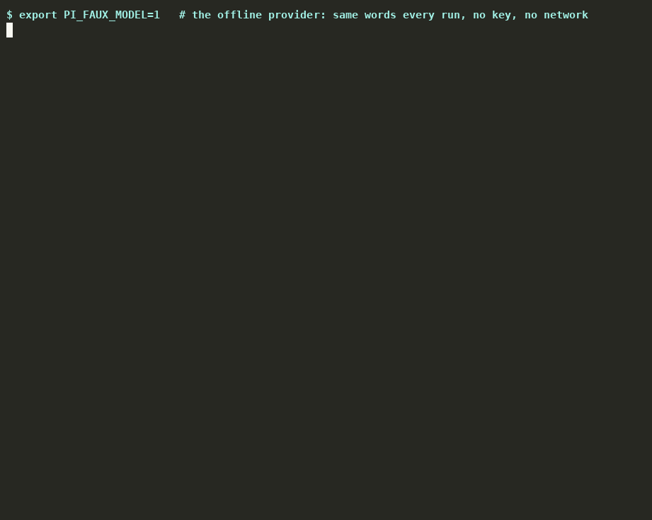

# mason

mason is an agent runtime developers use to build, connect and run agents — not a finished personal assistant, and not
a hosted service.

## The demo



The recording runs on a deterministic local model (`PI_FAUX_MODEL=1`), not a hosted one: the bot answers the same words
every time, and no provider, key or network is involved. It is a throwaway home under `/tmp`, which is why the connector
credential it prints is one that was discarded.

## Install

Node.js 26.4.0 or newer, and npm 11.

The floor is one version for everything — the runtime, the CLI and the connector SDK: mason runs its TypeScript from
source and keeps its state in `node:sqlite`, so there is no second version to check.

```sh
npm install -g mason-agent
mason init --provider <id> --model <id> --key <key>
mason new bot
```

Or with Nix, from a checkout:

```sh
nix run github:DenisSud/mason            # or: nix profile install github:DenisSud/mason
```

## First run

The first run is flags, in two commands, and nothing prompts: `mason init` stores a provider, a model and a key —
checked with one real completion before anything is written — and `mason new <name>` makes the bot's home under the root
(`~/.mason`, or `$MASON_ROOT`): the soul, the profile, the skills, and the built-in console connector's grant and
credential. Run `init` again and it asks nothing; it reports what is there.

```sh
mason up     # serve the bot, so its connector socket answers
mason chat   # a conversation in this terminal, through the console connector
```

`mason new` ends with `mason doctor`, the read-only checks over what it just wrote. `mason chat --once "hello"` sends
one message, prints the answer and exits, for a script or a pipe.

## What it is, and how it runs

One process per bot, and one owner per bot: the actor a connector's grant names is the person whose words are the
owner's, and anybody else's are refused.

A bot's home holds everything it is — soul, profile, skills, routines, credentials, its database, and the workspace its
tools run in — and nothing about it lives outside that home. Sessions are durable, so a restart is a pause and not a
reset; a routine's timer or an event a connector fires can wake the bot with nobody typing.

Connectors are the only door a person speaks through: words arrive on a connector's socket, and the answer is a row of
the conversation that socket reads. There is no web UI, no owner token and no panel. `/api/health` is the one path that
answers without a credential, and it answers one word.

## Connectors and integrations

Two words, two jobs. A **connector** is how a person talks to a bot. An **integration** is a service or tool the bot
operates.

v0.1.0 ships one connector: the console, which is `mason chat` in the terminal the bot runs in. It is built in because
there is nothing to install — the command opens the same socket every other connector opens. Telegram is not in this
release.

`mason integration add|remove|enable|disable|list` is how a bot gains a service. `mason status` says what one bot is and
whether it is up, and `mason doctor` checks it.

## Current limitations

- **0.1.0.** Expect breaking changes between releases; nothing here promises a stable API.
- **Console only.** There is no web UI, and no second way to reach a bot.
- **One owner per bot, one process per bot.** There is no multi-user access.
- **The console is a developer adapter.** It holds the one user grant, so it and a real chat connector cannot both be
  enabled; the terminal interface is gone (#201).
- **Single host.** The runtime, the home and the machine its tools run on are one machine.
- **Configuration is JSON files** under the home. They can be hand-edited, but you should not need to.

## Development

[CONTRIBUTING.md](CONTRIBUTING.md) has the development setup, the checks to run and how to propose a change. Defects
and proposals go to the [issue tracker](https://github.com/DenisSud/mason/issues).

## Licence

AGPL-3.0-only. The terms are in [LICENSE](LICENSE), and the source is
[github.com/DenisSud/mason](https://github.com/DenisSud/mason).
